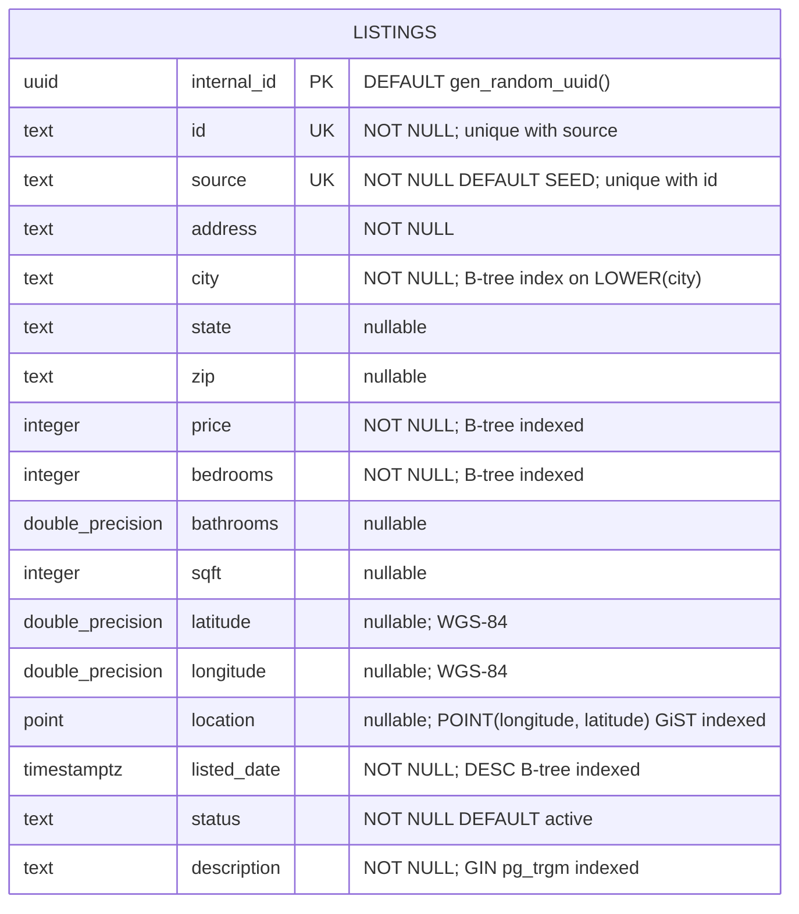

# Real Estate Search — Software Requirements Specification (EARS)

This document defines the functional, user interface, validation, and error-handling requirements for the Real Estate Search application. All requirements follow the Easy Approach to Requirements Syntax (EARS) and ASD-STE100 Simplified Technical English principles (atomic statements, active voice, consistent terminology, and concise sentences).

## EARS Pattern Reference

- Ubiquitous: `The <system> shall <response>.`
- Event-Driven: `WHEN <trigger>, the <system> shall <response>.`
- State-Driven: `WHILE <state>, the <system> shall <response>.`
- Unwanted Behavior: `IF <unwanted condition>, THEN the <system> shall <response>.`
- Optional Feature: `WHERE <feature/condition>, the <system> shall <response>.`

## Folder structure

`./src/ui/`: User interface
`./src/api/`: API

## Tech stack

### User interface
- React 18+
- TypeScript (strict mode)
- Vite (build/dev) & Nginx (production container server)
- MUI (@mui/material) — Material Design component library
- Apollo Client — GraphQL fetching & stale-request cancellation
- GrpahQL codegen with react hook generation
- Zod — client-side input validation
- Vitest + React Testing Library — unit & component testing
- Playwright — end-to-end (E2E) browser testing

### API
- Node.js + TypeScript (strict mode)
- GraphQL (GraphQL Yoga or Apollo Server)
- PostgreSQL
- Drizzle ORM — schema migrations, deterministic seeding, and type-safe queries
- Zod — authoritative input validation & structured error formatting
- Vitest — unit & API integration testing
- Containerized

## Non-functinal requirements
- >90% unit test coverage
- Integration test coverage of all user jouneys, happy paths and failure modes.
- Import facilty of the provided '[sample](<./sample_listings.json>)
- Docker compose for the full stack.

---

## 1. Architecture & Search Execution

- REQ-ARCH-001: The application shall provide a web user interface (UI) for searching real estate listings.
- REQ-ARCH-002: WHEN the user submits search criteria, the UI shall send a search request to the search engine.
- REQ-ARCH-003: WHEN a search request succeeds, the search engine shall return a structured GraphQL result (`SearchListingsSuccess`) with the matching listings and pagination metadata.
- REQ-ARCH-004: WHEN the search engine receives identical inputs for an unchanged dataset, the search engine shall return identical outputs.

---

## 2. Listing Filtering

- REQ-FLT-001: The search engine shall accept the optional filter parameters `minPrice`, `maxPrice`, `minBedrooms`, `city`, and `keyword`.
- REQ-FLT-002: WHERE `minPrice` is provided, the search engine shall include only listings with `price` greater than or equal to `minPrice`.
- REQ-FLT-003: WHERE `maxPrice` is provided, the search engine shall include only listings with `price` less than or equal to `maxPrice`.
- REQ-FLT-004: WHERE `minBedrooms` is provided, the search engine shall include only listings with `bedrooms` greater than or equal to `minBedrooms`.
- REQ-FLT-005: WHEN `city` or `keyword` is provided, the search engine shall trim leading and trailing whitespace from the value before filtering.
- REQ-FLT-006: WHERE `city` is non-empty after trimming, the search engine shall include only listings whose `city` matches `city` without case sensitivity.
- REQ-FLT-007: WHERE `keyword` is non-empty after trimming, the search engine shall include only listings whose `description` contains `keyword` without case sensitivity.
- REQ-FLT-008: The search engine shall return only listings that satisfy all active filters.
- REQ-FLT-009: WHERE a filter parameter is omitted or empty after trimming, the search engine shall not filter listings by that parameter.

---

## 3. Relevance Scoring & Ranking

- REQ-RNK-001: The search engine shall accept an optional `targetBudget` parameter.
- REQ-RNK-002: The search engine shall compute a numeric relevance score for each listing that matches the active filters.
- REQ-RNK-003: WHERE `targetBudget` is provided, the search engine shall compute each listing's relevance score as a weighted sum of a budget-proximity score and a recency score.
- REQ-RNK-004: WHERE `targetBudget` is provided, the search engine shall assign a higher budget-proximity score to a listing with a smaller absolute relative difference between `price` and `targetBudget`.
- REQ-RNK-005: The search engine shall assign a higher recency score to a listing with a more recent listed date.
- REQ-RNK-006: WHERE `targetBudget` is omitted, the search engine shall compute each listing's relevance score from the recency score alone.
- REQ-RNK-007: The search engine shall bound each relevance score to the range `0.00` to `1.00`.
- REQ-RNK-008: The search engine shall sort matching listings by relevance score in descending order.
- REQ-RNK-009: WHEN two matching listings have equal relevance scores, the search engine shall order the listing with the more recent listed date first.
- REQ-RNK-010: WHEN two matching listings have equal relevance scores and equal listed dates, the search engine shall order the listing with the lower identifier first.
- REQ-RNK-011: The repository documentation shall specify the relevance scoring formula, component weights, and normalization rules.

---

## 4. Pagination

- REQ-PAG-001: The search engine shall accept the optional pagination parameters `page` (1-indexed page number) and `pageSize` (maximum listings per page).
- REQ-PAG-002: WHERE `page` is omitted, the search engine shall set `page` to `1`.
- REQ-PAG-003: WHERE `pageSize` is omitted, the search engine shall set `pageSize` to `10`.
- REQ-PAG-004: WHEN a valid search matches one or more listings, the search engine shall return only the ranked listings for the requested `page` and `pageSize`.
- REQ-PAG-005: WHEN a search request succeeds, the search engine shall include `page`, `pageSize`, `totalResults`, and `totalPages` in the pagination metadata.
- REQ-PAG-006: WHEN the user changes any filter parameter, `targetBudget`, or `pageSize`, the UI shall reset `page` to `1` before sending the search request.
- REQ-PAG-007: WHEN the user activates a pagination control, the UI shall request the selected `page`.
- REQ-PAG-008: WHEN the user navigates between pages, the UI shall preserve the active filter parameters, `targetBudget`, and `pageSize`.
- REQ-PAG-009: WHILE `page` equals `1`, the UI shall disable the Previous Page control.
- REQ-PAG-010: WHILE `page` equals `totalPages` or `totalPages` equals `0`, the UI shall disable the Next Page control.

---

## 5. User Interface Inputs, Display, and States

- REQ-UI-001: The UI shall provide input controls for `minPrice`, `maxPrice`, `minBedrooms`, `city`, `keyword`, `targetBudget`, and `pageSize`.
- REQ-UI-002: The UI shall provide Previous Page and Next Page navigation controls.
- REQ-UI-003: WHEN search results are returned, the UI shall display the listings in ranked order.
- REQ-UI-004: The UI shall display the `address`, `price`, `bedrooms`, and `relevance score` for each listing.
- REQ-UI-005: The UI shall format each listing's `price` as currency.
- REQ-UI-006: WHILE a search request is in progress, the UI shall display a loading indicator.
- REQ-UI-007: WHEN an out-of-order search response arrives after a newer request has been sent, the UI shall discard the older response.
- REQ-UI-008: WHEN a valid search returns zero matching listings, the UI shall display an empty-results message stating that no listings matched.
- REQ-UI-009: WHEN a valid search returns zero matching listings, the UI shall display guidance to broaden the search criteria.
- REQ-UI-010: WHERE a Reset Filters control is provided, WHEN the user activates the control, the UI shall reset all search inputs to their default values.
- REQ-UI-011: WHEN search inputs are reset to their default values, the UI shall execute a search with the default parameters.
- REQ-UI-012: WHILE search results are displayed, the UI shall display `page`, `totalPages`, and `totalResults`.

---

## 6. Input Validation & GraphQL Error Handling

Expected domain errors (input validation and out-of-range pagination) follow the GraphQL **Errors as Data** pattern via a GraphQL union (`SearchListingsResult = SearchListingsSuccess | SearchValidationError | SearchOutOfRangeError`) returned with HTTP `200 OK` per the GraphQL-over-HTTP specification. Numeric/integer search input fields use an uncoerced pass-through scalar (`JSONScalar`) so malformed values reach domain validation cleanly (`REQ-VAL-003`). Unexpected database or server failures surface via standard GraphQL top-level `errors` (`extensions.code = "INTERNAL_SERVER_ERROR"`) with masked messages and a nullable `searchListings` field, while HTTP `400 Bad Request` is reserved for malformed HTTP/JSON payloads or GraphQL syntax/validation failures before execution.

- REQ-VAL-001: WHEN the user submits a search, the UI shall validate all search inputs before sending the request.
- REQ-VAL-002: WHEN the search engine receives a search request, the search engine shall validate all search inputs before executing the search.
- REQ-VAL-003: IF any input parameter is invalid, THEN the search engine shall reject the request without coercing or ignoring the invalid value.
- REQ-VAL-004: IF `minPrice` is non-numeric or less than `0`, THEN the search engine shall return a validation error for `minPrice`.
- REQ-VAL-005: IF `maxPrice` is non-numeric or less than `0`, THEN the search engine shall return a validation error for `maxPrice`.
- REQ-VAL-006: IF `minPrice` is greater than `maxPrice`, THEN the search engine shall return a validation error indicating that `minPrice` must not exceed `maxPrice`.
- REQ-VAL-007: IF `minBedrooms` is non-numeric, non-integer, or less than `0`, THEN the search engine shall return a validation error for `minBedrooms`.
- REQ-VAL-008: IF `targetBudget` is provided and is non-numeric or less than or equal to `0`, THEN the search engine shall return a validation error for `targetBudget`.
- REQ-VAL-009: IF `pageSize` is non-numeric, non-integer, or less than or equal to `0`, THEN the search engine shall return a validation error for `pageSize`.
- REQ-VAL-010: WHERE a maximum `pageSize` is configured, IF `pageSize` exceeds the maximum, THEN the search engine shall return a validation error for `pageSize`.
- REQ-VAL-011: IF `page` is non-numeric, non-integer, or less than `1`, THEN the search engine shall return a validation error for `page`.
- REQ-VAL-012: IF `totalResults` is greater than `0` and `page` exceeds `totalPages`, THEN the search engine shall return an out-of-range error (`SearchOutOfRangeError`) that includes `totalPages`.
- REQ-ERR-001: IF a validation error or request failure occurs, THEN the UI shall display an error message describing the failure.
- REQ-ERR-002: IF a validation error or request failure occurs, THEN the UI shall clear any previously displayed listing results.
- REQ-ERR-003: IF a validation error or request failure occurs, THEN the UI shall allow the user to edit search inputs and retry without reloading the page.
- REQ-ERR-004: IF the search engine executes a query that fails input validation or pagination bounds, THEN the GraphQL endpoint shall return an error union variant (`SearchValidationError` or `SearchOutOfRangeError`) with a `SearchErrorCode` over HTTP `200 OK`; IF an unexpected server or database error occurs during execution, THEN the GraphQL endpoint shall return a GraphQL top-level `errors` entry with `extensions.code` set to `"INTERNAL_SERVER_ERROR"` and set `data.searchListings` to `null`.
- REQ-ERR-005: IF the search engine receives invalid input, THEN the GraphQL error union variant (`SearchValidationError` / `SearchOutOfRangeError` implementing `SearchError`) shall include a structured `code`, `message`, and `field`.
- REQ-ERR-006: IF the search engine receives invalid input, THEN the search engine shall handle the error without throwing an unhandled exception, and unexpected internal resolver failures shall return sanitized GraphQL `errors` without leaking internal stack traces or database details.

---

## 7. Internal Data Model

The search engine persists all listings in the PostgreSQL `listings` table (`packages/api/src/db/schema.ts` and `packages/api/src/db/client.ts`). Surrogate `internal_id` (`UUID`) serves as the primary key, while `(id, source)` enforces multi-feed uniqueness.

### Indexes

- `listings_pkey`: Primary key on `(internal_id)`.
- `listings_id_source_unique`: Unique composite B-tree index on `(id, source)`.
- `listings_listed_date_desc`: Descending B-tree index on `(listed_date DESC)`.
- `listings_price_idx`: B-tree index on `(price)`.
- `listings_bedrooms_idx`: B-tree index on `(bedrooms)`.
- `listings_city_lower_idx`: Expression B-tree index on `(LOWER(city))`.
- `listings_location_gist`: GiST spatial index on `(location)`.
- `listings_description_trgm`: GIN trigram index (`gin_trgm_ops`) on `(description)` when `pg_trgm` is available.

